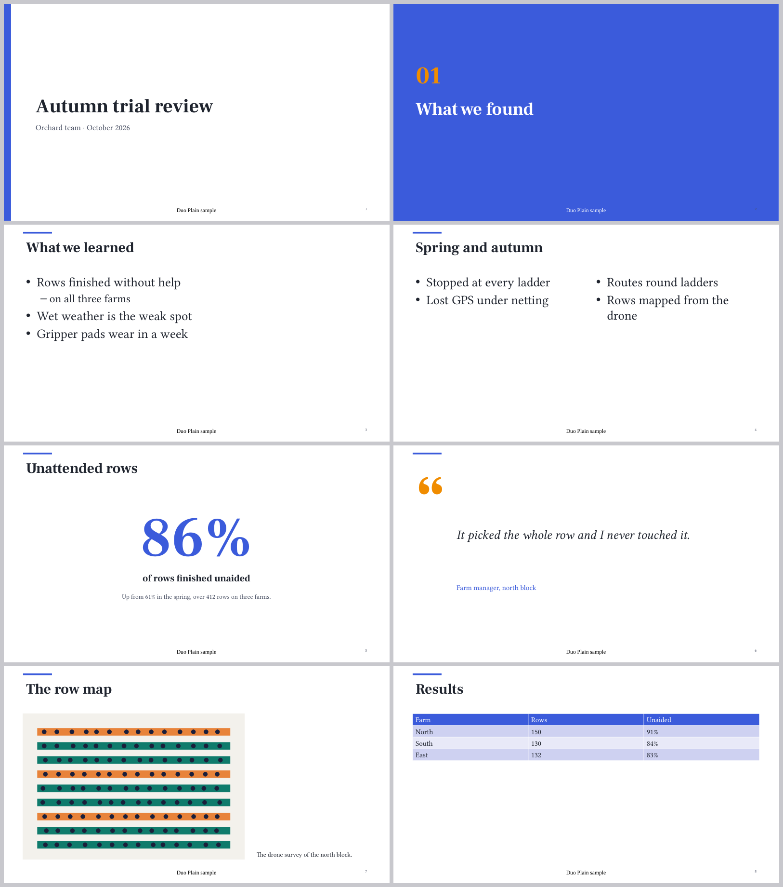

# Duo Decks P1: write a deck, check it, export it

P1 of `plan.md` §6: the convention, parser, checker and writer from P0 become a target of their own and `duo2 deck` verbs, with the carry-over rules for a changed template, dated exports, a built-in pack and a section in the skill. All of it runs in the CLI with Duo closed; no UI, no visible run. Decisions followed: DL-267, DL-268, DL-270, DL-281, DL-282, DL-284, DL-285, DL-286, DL-290.

## What is built

| Piece | Where | Notes |
|---|---|---|
| Target `DuoDeck` | `Sources/DuoDeck/` | The P0 code (ZipWriter, DeckParse, DeckCheck, PptxWriter, DeckInspect) moved out of DuoSearch, plus the new files below. `duo2`, `DuoKit` and `DuoChecks` depend on it. |
| Empty slots are notices | `DeckCheck.swift` | `Checked.notices`; a `## slot` with nothing under it, or a template slot the slide leaves out, gives `slide n (template), slot: is empty`. Export goes ahead. The report prints `file:line: notice: …` and `no problems, 2 notices`. |
| Carry-over rules | `DeckRemap.swift` | `Deck.remap(slide, from:, to:, packOverrides:)`, a pure function; `Deck.changeTemplate(source:slide:to:pack:)` rewrites the slide in the file. |
| Pack overrides | `DeckParse.swift` | `from: {bullets: {body: left}}` in the target template's yaml block, read into `Template.overrides`. Several source templates and slots are allowed: `from: {bullets: {body: left}, kpi: {context: right}}`. |
| Dated exports | `DeckExport.swift` | `Deck.exportName`, `Deck.writeExport(deck:packDirs:dir:now:timeZone:)`: `<deck> YYYY-MM-DD HHmm.pptx` beside the deck, the earlier dated export removed. |
| Pack lookup, catalogue, scaffolding | `DeckPacks.swift` | `packDirs(near:)`, `catalogue`, `newDeckText`, `skeleton`, `insertSlide`. |
| Built-in pack `duo-plain` | `BuiltInPackData.swift`, `scripts/gen-duo-plain.py`, `scripts/duo-plain.md` | See below. |
| Verbs | `Sources/duo2/Deck.swift`, `Actions.swift` | `deck templates · check · export · insert · new · change · render`, all `local: true`, family `deck`. |
| Skill | `Installer.skill()` | A "Decks" section naming only these verbs. |
| Checks | `Sources/DuoChecks/DeckP1Checks.swift` | Called from `deckChecks()`; `DUO_CHECKS=deck` runs the P0 and P1 deck checks. |

### Decision: the target and its dependencies

`DuoDeck` depends on `DuoControl` and `DuoSearch`, and on nothing else. P0 reused two things that already sat below it:

- `Review.parse` (in `DuoControl`) finds the comment, highlight and suggestion marks that the parser strips (DL-284). `DuoControl` imports nothing from the deck code, so depending on it creates no cycle and nothing had to move.
- The read-only zip reader and XML node (`Pptx.Zip`, `Pptx.Node`, `Pptx.rels`, `Pptx.text`, in `DuoSearch`) read the pack's pptx. They were internal; they are now `public` (a one-word change per declaration, no behaviour change). `DuoSearch` depends on `DuoControl` only, so there is still no cycle: `DuoControl` ← `DuoSearch` ← `DuoDeck` ← `DuoKit` / `duo2`.

So DuoDeck can use Foundation, Compression (the zip writer) and CryptoKit (the source hash) and runs in the CLI, inside Claude's sandbox and on the work Mac. Not in DuoSearch any more because a deck is not a search source and the viewer (P3) will want the writer without linking SQLite and Core ML.

## The carry-over rules (DL-285), as built

`Deck.remap` takes the old slide, the old and new template, and (by default the new template's own) overrides. In order:

0. **The pack's own mapping** (`from:`) for that source template and slot, when the target slot exists and is unused.
1. **Same name and same kind** keeps its content. `title` stays `title` by this rule.
2. **The default slot** goes to the new default slot when the kinds match.
3. **The only unused slot of the same kind** takes the slot, when there is exactly one.
4. **Anything left** goes to the speaker notes.

Decisions on details the records leave open (for the lead to confirm):
- Rule 1 asks for the same **kind** as well as the same name; a text slot named `body` does not land in a bullets slot called `body`. Otherwise the checker would report the mismatch right after the change.
- Text with no heading counts as the old template's default slot, a lone image as its single image slot.
- The notes line is `Not placed after changing to <template>: <slot>, …`. One unplaced slot is followed by its lines; several are each introduced by `<slot>:`. The new text goes under the slide's existing `> [!note]` after a bare `>` line, or in a new callout at the end of the slide.
- The result lists **every** slot of the new template, in its order; those with nothing in them are empty (headings with no body), which is what the notice is for.
- **Comments travel with their slot (DL-284).** Parsing records each slot's `raw` lines as written, comments included, and the rewrite moves those lines, so a `{>>@sam …<<}` line inside a slot goes to the new slot, or into the notes with its text, as `> {>>…<<}`.
- A comment on the slide itself (outside every slot) and a trailing `---` stay where they were.

## The verbs

All local. Pack lookup is the project's `templates/decks/` (walking up from the deck's folder to the project), then Home's (from `_HOME.md` above the deck, else the Home Duo was told to use), then the built-in pack.

```
$ duo2 deck templates
duo-plain (…/duo-builtin-packs-328409b2ef31/duo-plain/duo-plain.md)
  title       title: text ≤60, subtitle: text ≤80 (default)
              The opening slide: the deck's name and who it's from. Once per deck, first.
  bullets     title: text ≤60, body: bullets ≤110 ×6 levels 2 (default)
              A heading and up to six points. Two levels at most. …
  kpi         title: text ≤40, value: number ≤7, label: text ≤45, context: text ≤140 (default)
              One number that matters, what it measures, and one line of context. …
  …

$ duo2 deck new decks/autumn-trial.md --template duo-plain
made decks/autumn-trial.md on the duo-plain pack (8 templates). See them with: duo2 deck templates decks/autumn-trial.md

$ duo2 deck insert decks/autumn-trial.md kpi --after 1
added slide 2 (kpi) to decks/autumn-trial.md: fill in title, value, label, context

$ duo2 deck check decks/autumn-trial.md
decks/autumn-trial.md:7: notice: slide 1 (title), subtitle: is empty
decks/autumn-trial.md:11: notice: slide 2 (kpi), title: is empty
…
no problems, 7 notices

$ duo2 deck change decks/autumn-trial.md 2 two-column
slide 2 is now two-column
  moved to the speaker notes ("Not placed after changing to two-column"): body
  empty now: left, right

$ duo2 deck export decks/autumn-trial.md
decks/autumn-trial.md:18: notice: slide 2 (two-column), left: is empty
wrote /tmp/p1demo/decks/autumn-trial 2026-10-31 1930.pptx (30940 bytes)
removed the earlier export autumn-trial 2026-10-31 1929.pptx

$ duo2 deck render decks/autumn-trial.md
duo2: deck render isn't built yet: it needs Duo's viewer (WebKit). …      [exit 2]
```

After `deck change`, slide 2 of the file reads:

```markdown
<!-- slide: two-column -->
# What we learned

## left

## right

> [!note]
> Pause here.
>
> Not placed after changing to two-column: body
> - Rows finished without help
> {>>@sam 2026-10-31 #c1: which farms?<<}
> - Wet weather is the weak spot
> - Gripper pads wear in a week
```

- `deck check` exits 1 when there are problems; notices don't. `deck export` refuses a deck with problems, prints its notices to stderr, and writes nothing.
- `deck change` and `deck insert` write the file in place. If the deck is open in Duo's editor, the editor's own save and the file change meet as any outside edit does (DL-78's `doc` verbs are the app's way; these two are file edits). A Duo-side `deck change` with undo is P3.
- `deck render` is registered (local) so `duo2 help deck` lists it, and says what it needs. It exits 2.
- Every verb prints `file:line` the way the checker did in P0. The deck path is printed as typed.

### Parity (DL-71)

The verbs are CLI-only: `ui:` is empty and no view names them, so the parity scan has nothing to match and nothing is left over. When P3 adds Change Template…, New Deck… and the others, each names its verb. The app answers a deck verb with the usual "runs in the CLI, not the app" (`AppModel+Control.swift`'s exhaustive switch needed the seven cases). `docs/cli/duo2.md` is regenerated.

## The built-in pack, `duo-plain`

Generated at dev time by `scripts/gen-duo-plain.py` with python-pptx (run `uv run --with python-pptx python scripts/gen-duo-plain.py`), not by Swift: building a theme, master and eight layouts from scratch in Swift would be a few hundred lines with no gain over a committed artefact. The generator adapts the Northwind sample's (same placeholders and idx, so the sample definition's slot tables carry over) with new colours, one accent colour, a short accent rule on the master and a side stripe on the title layout. No logo.

- **Fonts:** Inter for headings and text, a Google Font (DL-268). The definition says `google-heading-font: Inter`.
- **Layouts:** Title, Section, Title + Bullets, Two Column, Big Number, Quote, Image + Caption, Table (plus Title Only and Blank, unused), each with a footer (idx 11) and slide number (idx 12).
- **Cleaned for a pack:** the thumbnail is removed, `lastModifiedBy` is "Duo", the wrong `screen4x3` slide-size type is dropped (the P0 notes on the Northwind pack), and the zip is rewritten in sorted order with fixed times, so the output is repeatable for a given python-pptx.
- **Shipped as source:** `Sources/DuoDeck/BuiltInPackData.swift` holds the definition note and the pptx as base64 (about 30 KB). A Swift resource bundle would not reach `Contents/Helpers/duo2`, which is copied alone by `bundle.sh`; a string always does. On first use the pack is written to `$TMPDIR/duo-builtin-packs-<hash>/duo-plain/` (the hash of the content, so a newer Duo never reads an older copy) and found as the last pack folder.
- **Exports use it:** a deck of the eight templates exports and opens in python-pptx (layout names, placeholder idx and types, footers and slide numbers as in P0).

Not done: a `deck template specimen` for it (P2); an image template with a sample picture; thumbnails for a picker (P3).

## The skill

`Installer.skill()` has a "Decks" section after "Checking documents" (about 330 words): the file shape, `deck templates` before writing and never open the pptx, one bullet per line, split or cut rather than shrink, `deck check` after every edit, `deck change` and what it does to the notes, `deck export` and its dated name, comments stay in the Markdown, no python-pptx or `soffice`. It names only verbs in the registry (DuoChecks scans them). The template-making steps of plan §3.3 are left out until P2 has verbs for them.

## Checks and the build

All under the shared GPU lock (`--shared p1-build`), debug build, in the work tree.

| Run | Result |
|---|---|
| `swift build` (every product: Duo, duo2, DuoKit, DuoDeck, DuoChecks) | Build complete, no errors |
| `DUO_CHECKS=deck DuoChecks` | the P0 block **39 passed, 0 failed** (unchanged), the P1 block **57 passed, 0 failed** |
| Full `DuoChecks` | **2722 passed, 0 failed** |
| `duo2 help --markdown` against `docs/cli/duo2.md` | current (the Decks family added) |

The first full run found two real failures, fixed in this branch: `docs/cli/duo2.md` was stale, and the file-walk guard (F-302) wants every file that lists folders to use `ProtectedFolders` or be named in `walkGuardExempt` with why. `DeckExport.swift` lists the folder a deck is exported into (to find its earlier export) and `DeckPacks.swift` lists each `templates/decks` folder; both are one level, in the deck's own folder or a templates folder, and are now named there.

What the P1 checks pin:
- an empty slot is a notice and the deck still exports; the report prints notices after problems with their count;
- bullets to two-column (title stays, body to the notes under the naming line, two empty columns), kpi to bullets (value, label, context all unplaced, labelled), same template keeps every slot, unheaded text is the default slot;
- a pack override read from the yaml block (including several templates and slots) wins; with it the bullets land in `left`; overrides can also be passed in;
- `changeTemplate` on the sample deck: only the one slide changes (everything before and after is byte-identical), the old note stays with the new text under it, the result checks clean with two notices;
- a comment travels with its text into the notes (`> {>>@sam …<<}`) and with its slot when the pack maps it;
- export naming with an injected time and zone; matching only this deck's dated files; the next export removes the previous one and nothing else; the bytes do not depend on the time; `--out`; a failed export writes and removes nothing;
- the built-in pack (8 templates, Inter, lookup order, catalogue size), `deck new`/`insert` (`--after 0`, between, end), and a deck of 11 bare skeletons exports and opens by layout name;
- the skill's Decks section names only registered verbs and carries the rules; the deck verbs are local and have no UI.

Also done by hand with the built `duo2` (no app): the transcript above, python-pptx opening the export (3 slides, layouts, placeholder idx and types, notes), and LibreOffice rendering a deck of every duo-plain template: `img/p1/duo-plain-all-templates.png` (the deck is `img/p1/duo-plain-all-templates.md`). LibreOffice falls back to a serif where Inter is not installed; the shapes, colours and placeholders are the design.




## What is left

**P2, templates from your decks:** `deck template inventory · build · specimen`; promotion of slide-based templates; the CoreText fit check; the skill's template steps. The converting-a-pptx work of M3b (comments into Review marks, DL-290) lands here or beside it.

**P3, the viewer (after split view):**
- The Slides view, live re-render, slot picking and problems on slides, comment pins, using `Slot.marks`, `Slot.raw` and the line ranges P1 keeps.
- New Deck… (a sheet, Q-380) and Change Template… in menus, the picker and gallery of DL-281, the "N points moved to notes" strip with Move to left / Move to right / Split with Claude / Undo Change (the strip's deterministic moves are `Deck.remap`'s answer; undo goes through the editor, not the file).
- The `deck`, `deck go`, `deck pick` viewer verbs; `deck render` itself.
- Each UI action names its verb (DL-71).

**Smaller, found on the way:**
1. Multi-paragraph text slots are still joined into one paragraph (P0 note).
2. A mark spanning two slots lands on the slide, not a slot (P0 note 2); a comment after a slot's last line is in the slot's `raw` block (so it travels) but the anchor map still gives it to the slide.
3. `deck change` and `deck insert` write the file directly; a deck open and dirty in the editor wants the editor's path (P3).
4. `deck templates` without a deck lists every pack found from the current folder; with Home unset it lists project packs and `duo-plain`.
5. Git: the dated export is removed from the working tree; making the removal and the new file one commit is the committer's job (DL-286: "in the same commit when Duo commits").
6. The timestamp uses the Mac's time zone at the moment of export. Two exports in one minute write the same file.
