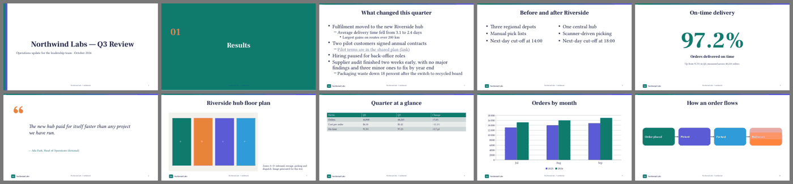
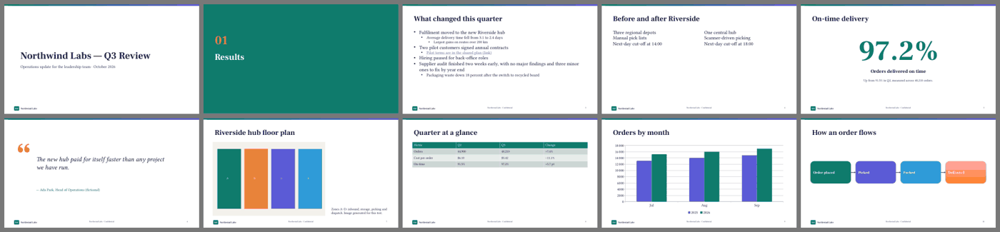

# Duo Decks study: pptx fidelity through Google Slides, and template extraction

Research prototype for Duo Decks, 2026-10-31. Nothing here is built into the app. All content is synthetic ("Northwind Labs").

**Bottom line.** Build the export by filling a reference template's layout placeholders by `idx`. Don't build it from absolutely positioned text boxes. Google Slides keeps placeholder `type`/`idx` and exact EMU geometry, but it **renames layouts and shapes** and **bakes theme fonts into every run**. So a Duo template definition must key on `idx` + geometry, never on names, and the re-import path (Google → pptx → Duo) has to match layouts structurally.

**Two caveats on the evidence:**
- The live Google test was much smaller than planned (see *What the Google test could and could not do*). Only a one-slide python-pptx deck made the full round trip, from upload and conversion to read-back, pptx re-export and PDF re-export.
- The full synthetic template and both 10-slide decks were built and checked in LibreOffice, but none of them could be uploaded intact. The Google columns below mark which rows were tested and which come from secondary sources.

## 1. What was built

`prototypes/pptx/` (scratch outputs were in the job's tmp dir and are not committed):

| Script | What it does |
|---|---|
| `gen_template.py` | Builds a synthetic reference template (`template.pptx`) from python-pptx's default. It has a custom colour scheme (Northwind: accent1 `0F7B6C`…), and theme fonts major **Avenir Next** (not a Google font) and minor **Inter** (a Google font). The master carries a gradient accent bar (scheme accent1→accent3), a logo (theme-filled rounded rect + wordmark), and title/body/footer/slide-number placeholders. There are 10 named layouts: Title, Section (layout bg = accent1), Title + Bullets, Two Column, Big Number (custom body placeholders idx 13/14/15), Quote, Image + Caption (`pic` placeholder), Table (`tbl` placeholder), Title Only and Blank. Each layout has `ftr` idx 11 and `sldNum` idx 12. 16:9. |
| `gen_decks.py` | Builds the same 10 slides two ways. **(i) placeholder**: each slide uses its named layout and text goes in by `idx`; the picture uses `insert_picture`, the table `insert_table`, and footers are cloned from the layout. **(ii) absolute**: every slide is on Blank, with text boxes at the layout's EMU geometry, explicit font names and RGB colours (what pptxgenjs/html2pptx-style generators emit), and explicit bullets and slide-number fields. Both decks also have a native column chart (theme-coloured series), a grouped 4-step diagram (theme fills, one gradient, arrow connectors) standing in for SmartArt, speaker notes, a hyperlink, 3-level bullets, and `normAutofit fontScale=77.5%`. |
| `lean.py` | Shrinks a pptx to the smallest valid OOXML (flat short part names, optional parts dropped, notes master minimised) so the base64 that passes through the model's context stays small. |
| `inventory.py` | The deterministic extractor: theme, master, layouts, slides. See §4. |
| `transcript_tool.py` | Recovers exact Drive download bytes from the session transcript, and checks what was actually sent in an upload. |
| `sheet.py` | Renders PDF pages to a contact sheet. |

LibreOffice renders (`soffice --headless`, run under the shared GPU lock, no window):




Both decks look the same, which is the point: the pixels match and the structure differs. Visible differences:
- **Layout decoration.** On the absolute deck's Title slide the layout decoration (the left brand stripe) is lost, because Blank shows only the master. On its Section slide the layout background had to be faked with a full-bleed rectangle.
- **Typography.** The placeholder deck inherits title centring and type sizes from the master's `txStyles`. The absolute deck hard-codes them.
- **Fonts.** LibreOffice here falls back to a serif for both Avenir Next and Inter (fontconfig doesn't see them). This is a renderer issue, not a pptx one, but it is a reminder that every consumer substitutes fonts differently.

## 2. What the Google test could and could not do

**The transport problem.** The Drive connector's `create_file` takes the file as a `base64Content` string, so the model has to retype every character of it. That is not reliable:
- I checked the payloads actually sent (they are recorded in the session transcript; see `transcript_tool.py`) against the local files. At about 13–25 K characters there was 1 substitution per ~13 K characters, and at 100 K characters it was much worse.
- Every corrupted pptx was rejected with `Invalid conversion requested`, `Request contains an invalid argument` or `not a valid base64 string`.
- Sonnet subagents given the same job failed the same way.
- Shrinking a deck to the floor (master + theme + 1 layout + 1 slide) still gives about 10 K characters, because the master and theme alone are about 6 KB deflated. So my synthetic template could never be uploaded intact.
- **Downloads are fine.** The connector returns the base64 inline. The session transcript holds it verbatim, so `transcript_tool.py` writes the exact bytes to disk with no retyping.

**What did go through:**

| Drive file | id | Result |
|---|---|---|
| Folder **Duo Decks tests** | in the task note (private) | created in My Drive, not shared |
| `tiny conversion test` (python-pptx default template, 1 layout "Title Slide", 1 slide; 12 KB pptx, converted) | in the task note | **converted**; read back, re-exported as pptx and as PDF |
| `G1 original pptx (not converted).pptx` (placeholder bullets + KPI slides, unconverted) | in the task note | uploaded, but **the bytes differ from the source** (a substitution at byte 3134), so the file is corrupt and is not evidence. It is left in the folder; delete it if you like. |

Every other upload failed and created no file (the combined 20-slide deck, a 4-slide subset, the 2-slide subsets, the 1-slide subsets).

**To finish the test properly**, the pptx files have to reach Drive by a byte-exact path. Any of these would do: a Drive tool that takes a local file path, Drive for desktop sync plus "Open with Google Slides", or a short `gdrive`/`rclone` script on the Mac mini. With that in place, `gen_template.py`, `gen_decks.py` and `inventory.py` give a complete rerun as they stand. This is open question **Q-A** in §6.

## 3. Fidelity matrix

**Columns:**
- *Placeholder deck* and *Absolute deck*: what our generated pptx holds (checked with `inventory.py` and LibreOffice).
- *Google import*: what the Slides editor holds after conversion.
- *Google → pptx*: what comes back in Google's pptx export.

**Evidence codes:**
- **T** = tested here (the tiny round trip).
- **S** = secondary sources only: third-party guides; Google publishes no list of unsupported import features (its help pages [9310378](https://support.google.com/docs/answer/9310378?hl=en) don't say).
- **K** = known OOXML / python-pptx behaviour.
- **—** = not tested.

| Feature | Placeholder deck | Absolute deck | Google import | Google → pptx |
|---|---|---|---|---|
| Layout linkage (slide → named layout) | yes, 10 layouts | all slides → Blank | **T** kept: the slide uses the imported layout, and the master/layout placeholders survive | **T** layout kept, but **renamed to its type**: "Title Slide" → `TITLE`. Custom display names are lost (custom `cust` layouts untested: —) |
| Unused layouts | kept in the file | n/a | — (Google is widely reported to keep the master's layouts; not verified) | — |
| Placeholder `type` + `idx` | yes (incl. custom body idx 13–15) | none | **T** kept (`ctrTitle`, `subTitle idx=1`, `dt/ftr/sldNum` 10/11/12) | **T** kept |
| Placeholder geometry | inherited from layout | explicit on each box | **T** exact | **T** exact EMU, now **written explicitly on every slide shape** (inheritance flattened) |
| Shape names | meaningful ("KPI Value") | meaningful | **T** replaced | **T** `Google Shape;21;p3`. **Names are not a stable key.** |
| Theme colours as scheme refs | yes (`schemeClr accent1`…) | text RGB; decoration scheme | **T** kept as scheme refs (`tx1` written as `dk1`) | **T** kept as `schemeClr`; the colour scheme values survive |
| Theme fonts (`+mj-lt`/`+mn-lt`) | yes | explicit names | **T** resolved | **T** the theme `fontScheme` is **rewritten to Arial**, and the resolved font (Calibri) is **baked into every run** (`latin/ea/cs/sym`) and into the master text styles. Theme-font indirection is lost. |
| Non-Google font (Avenir Next) | theme major font | explicit | **S** shown under its own name if missing, substituted when rendered; guides say it becomes Arial once edited and saved | — (Calibri, which Google Fonts has, survived and was embedded in the PDF) |
| Run formatting | inherited from `lstStyle`/master | explicit | **T** | **T** every run gets explicit `sz`, typeface, colour; `bodyPr` insets made explicit. **Inherited formatting is flattened.** |
| Autofit `normAutofit fontScale` | set on bullets | set | **T** `normAutofit` kept (without a fontScale in the test) | **T** `normAutofit` present; fontScale untested (—) |
| Bulleted levels 0–2 | via master `txStyles` | explicit `buChar`/`marL` | — | — |
| Hyperlinks | yes | yes | — (expected kept, **S**) | — |
| Speaker notes | yes | yes | **T** notes part exists after import | **T** Google always writes a notesMaster + notesSlide, even when the source had none |
| Footer / slide number | `ftr`/`sldNum` placeholders cloned onto slides | text box + `fld slidenum` | — | **T** master and layout carry dt/ftr/sldNum idx 10/11/12 |
| Native table | `tbl` placeholder + style id | `graphicFrame` table | — (**S** native) | — |
| Native chart | yes (cached values; workbook stripped for upload) | yes | **S** guides say Excel charts are not live in Slides (Google suggests Sheets charts); expect an image or static chart | — |
| SmartArt | not authored (python-pptx can't; LibreOffice sample download blocked) | — | **S** sources disagree: "group of shapes" vs "image" | — |
| Grouped diagram, theme fills, gradient | group of 4 shapes + connectors, 1 gradient | same | — | — |
| Picture placeholder (`pic`) crop-fill | `insert_picture` | stretched `add_picture` | — | — |
| Layout background (Section) | layout `bg` = accent1 | full-bleed rect | — | — |
| Slide size | 16:9 | 16:9 | **T** kept (4:3 test file stayed 4:3) | **T** kept |
| docProps (title/author) | yes | yes | — | **T** dropped (no docProps in export) |
| Text read-back (`read_file_content`) | | | **T** returns Markdown-ish text: `# Tiny conversion test` | |

**Placeholder vs absolute: which survives better?** On the tested evidence, a placeholder deck keeps its structure through Google: the layout link, placeholder type/idx and exact geometry. An absolute deck has no structure to keep. Both come back looking the same, because Google bakes explicit formatting into everything anyway. So Google doesn't make the placeholder deck look better; it **keeps it re-editable and re-mappable**:
- A user who changes layouts or theme in Slides gets sensible behaviour.
- A deck pulled back from Google can be mapped onto Duo's template by placeholder `idx`/type and geometry.

For an absolute deck, all Duo could do on the way back is guess slots from shape positions.

## 4. Template extraction

### 4.1 Use layouts and placeholders, not slide geometry, when the source has them

A slide placeholder inherits from the layout placeholder with the **same `idx`**. A layout placeholder inherits from the master placeholder with the **same `type`**. (python-pptx: "A slide placeholder inherits from the layout placeholder having the same idx value"; "A layout placeholder inherits from the master placeholder sharing the same type"; position, size, fill, line and font all inherit, and direct formatting overrides.)

So a layout already is a template: its placeholders are the slots. Filling a slot by idx keeps the deck editable in PowerPoint and Slides ("Reset slide" works, a theme change reflows). The same mechanism underlies the other tools:
- **python-pptx** is `slide.placeholders[idx]`.
- **pandoc's** `--reference-doc` picks layouts **by name** (Title Slide, Title and Content, Section Header, Two Content, Comparison, Content with Caption, Blank) and falls back to its default when a name is missing ([Quarto docs](https://quarto.org/docs/presentations/powerpoint)).
- **pptx-automizer** copies whole template *slides* and edits their shapes by name. It can't add or edit individual layouts ([repo](https://github.com/singerla/pptx-automizer)).

Real-world decks often put the design on ordinary slides: free text boxes on a Blank or Title Only layout. For those, extraction has to:
1. Take a "template slide" and list its shapes with geometry.
2. Decide which shapes are slots and which are decoration.
3. **Promote** it: write a new `sldLayout` whose placeholders sit at the slot geometry with the slot's typography in `lstStyle`, and move the decoration onto the layout as non-placeholder shapes.

Duo can do step 3 deterministically (`gen_template.py`'s `ph()`/`set_tree()` show the XML) once Claude has made the slot/decoration call in step 2. Custom body placeholders should use **idx ≥ 13**, because PowerPoint reserves 10/11/12 for dt/ftr/sldNum.

### 4.2 Deterministic vs inferred

| Must be deterministic (read from XML, never guessed) | Claude can infer (then a human approves) |
|---|---|
| placeholder `type`, `idx`, layout `type`, master and layout part identity | slot **names** ("kpi_value", "caption"), and each layout's **purpose** ("one big metric with label and context") |
| geometry in EMU (off/ext), and slide size | slot **kind** (text vs bullets vs number vs image vs table vs chart) where `type=body` is ambiguous |
| theme colour scheme, font scheme (major/minor), resolved font per slot | **text limits** (max chars/lines), estimated from box size × font size × autofit |
| `lstStyle` sizes/colours, bullet levels, `bodyPr` autofit/anchor/insets | which shapes are **decoration** vs content on a slide-based template (logo, stripes, quote marks) |
| `showMasterSp`, layout background, `pic`/`tbl`/`chart` placeholder kinds | when to use a layout ("use for a single number ≥ 1 headline"), and example content |
| picture crop behaviour, table style id | names for unnamed or duplicate layouts |

What the inventory gave that Claude could not have seen from a rendered image:
- idx 13/14/15 on Big Number.
- Which `body` placeholders have `buNone` (single-value slots) and which use master bullets.
- The 138 pt / `+mj-lt` / `scheme:accent1` styling of the KPI.
- `normAutofit` on every slot, `showMasterSp=0` on Title/Section, and the Section layout background.

What Claude could add that the XML does not say:
- Big Number's three body placeholders are *value / label / context*.
- The quote mark on Quote is decoration.
- The caption box takes about 220 characters.
- Image + Caption is for a single visual.

### 4.3 Draft template definition (hand-written "as Claude", from `inventory.py` output)

```yaml
# northwind.deck-template.yaml — generated from template.pptx; inferred fields marked "# inferred"
template: northwind-labs
source: { file: template.pptx, sha256: <of source pptx>, slide_size_emu: [12192000, 6858000] }
theme:                      # deterministic, copied from theme1.xml
  colors: { dk1: "#1B1F3B", lt1: "#FFFFFF", dk2: "#2E3A59", lt2: "#F3F1EC", accent1: "#0F7B6C",
            accent2: "#E8833A", accent3: "#5B5BD6", accent4: "#D6455D", accent5: "#2F9BD8", accent6: "#8C9A2B" }
  fonts: { heading: "Avenir Next", body: "Inter" }
  google_safe_fonts: { heading: "Nunito Sans", body: "Inter" }   # inferred substitute; needs approval
footer: { idx: 11, default: "Northwind Labs · Confidential" }
slide_number: { idx: 12 }

layouts:
  bullets:                                   # inferred key
    pptx_layout: { name: "Title + Bullets", type: obj, fingerprint: "title@0+body@1" }   # deterministic match key
    purpose: "Heading plus up to ~8 bullets, two levels of nesting"            # inferred
    slots:
      title:   { idx: 0, type: title, kind: text,    max_chars: 60, max_lines: 1,
                 geom_emu: [609600, 365125, 10972800, 1000000], font: heading, size_pt: 36 }
      bullets: { idx: 1, type: body,  kind: bullets, levels: 3, max_items: 8, max_chars_per_item: 110,
                 geom_emu: [609600, 1500000, 10972800, 4600000], autofit: shrink, min_scale: 0.75 }
  kpi:
    pptx_layout: { name: "Big Number", type: cust, fingerprint: "title@0+body@13+body@14+body@15" }
    purpose: "One headline metric with what it measures and context"           # inferred
    slots:
      title:   { idx: 0,  type: title, kind: text,   max_chars: 40 }
      value:   { idx: 13, type: body,  kind: number, max_chars: 7, size_pt: 138, color: accent1, font: heading,
                 note: "e.g. 97.2%, $4.1M; no sentence" }                       # inferred
      label:   { idx: 14, type: body,  kind: text,   max_chars: 45, max_lines: 1, size_pt: 24 }
      context: { idx: 15, type: body,  kind: text,   max_chars: 140, max_lines: 2, size_pt: 16, color: tx2 }
  image_caption:
    pptx_layout: { name: "Image + Caption", type: picTx, fingerprint: "title@0+pic@1+body@2" }
    purpose: "One image, left; caption bottom-right"                            # inferred
    slots:
      title:   { idx: 0, type: title, kind: text,  max_chars: 50 }
      image:   { idx: 1, type: pic,   kind: image, aspect: 1.52, fit: crop-fill,   # deterministic: pic ph + ext
                 geom_emu: [609600, 1500000, 7000000, 4600000] }
      caption: { idx: 2, type: body,  kind: text,  max_chars: 220, max_lines: 6, size_pt: 16, anchor: bottom }
decoration:                     # deterministic list, inferred role
  master: [ { name: "Accent Bar", role: brand-bar }, { name: "Logo Mark", role: logo }, { name: "Logo Wordmark", role: logo } ]
  layouts: { "Title": [ { name: "Brand Stripe", role: brand-bar } ], "Quote": [ { name: "Quote Mark", role: ornament } ] }
```

A deck's Markdown then names the layout key and fills slots (`layout: kpi`, `value: 97.2%`…). The exporter resolves `kpi` → `pptx_layout` by **fingerprint** (placeholder type@idx set), never by name alone, and writes text into `idx`. Text limits are advisory: the viewer warns, and the exporter relies on `normAutofit`.

## 5. Hard facts the plan must respect

1. **Fill placeholders by `idx`. Never write absolute text boxes when a layout slot exists.** Slide→layout inheritance is by `idx`, and layout→master by `type`. Use idx ≥ 13 for custom body slots; 10/11/12 are dt/ftr/sldNum.
2. **Footer, date and slide-number placeholders are not copied onto new slides** by python-pptx (PowerPoint copies them when "show footer" is on). The exporter must clone them from the layout, or the footer disappears.
3. **Google renames layouts to their type enum** ("Title Slide" → `TITLE`) **and every shape to `Google Shape;N;pN`**. Template matching on the way back must use placeholder type/idx sets plus geometry (a fingerprint), not names. Two layouts with the same type would collide on name alone.
4. **Google keeps placeholder type/idx, exact EMU geometry and scheme colour refs.** It **flattens inheritance**: explicit `xfrm` on every slide shape, explicit size and typeface on every run. After a Google round trip, the inherited styling of a placeholder deck is frozen in place.
5. **Google rewrites the theme font scheme (to Arial in the test) and bakes resolved font names into runs.** Theme-font indirection does not survive. Choose template fonts Google Fonts has (Inter, Source Sans 3…), or record a Google-safe substitute in the template definition. A non-Google font like Avenir Next will be substituted.
6. **Google drops docProps and always adds a notes master and notes slides.** Don't rely on core properties for round-trip metadata. Store a template id in something Google keeps (e.g. a notes marker or a hidden shape) — untested.
7. **Charts, SmartArt and tables are the unverified risk.** Secondary sources say Excel charts don't stay live, and SmartArt becomes groups or images. Treat charts as "native in pptx, possibly static in Google" until re-tested. Duo shouldn't emit SmartArt; emit grouped shapes.
8. **Theme colour refs survive, so emit `schemeClr`, not RGB**, for anything that should follow the template. Google writes `tx1` as `dk1`, so the mapping must accept both.
9. **python-pptx's `insert_picture` crops to fill the `pic` placeholder.** `add_picture` stretches. The template's slot aspect ratio matters.
10. **Store autofit as `normAutofit` with no fontScale and let the renderer compute it.** python-pptx's `fit_text` needs the font file. Text limits in the template are guidance for Claude, not a guarantee.
11. **The Drive connector can't upload binaries reliably.** Its base64 parameter is retyped by the model and corrupts above ~10 K characters. A Google Slides export feature, or a test harness, needs a byte-exact upload path: the Drive API from a local process, or a connector that takes a file path. Downloads are fine.

## 6. Open questions

- **Q-A**: rerun the full Google test (template + both decks + re-export diff) over a byte-exact upload path. Which path should Duo use: a Drive API OAuth app, or Drive for desktop?
- **Q-B**: does Google keep **unused** layouts, `cust` layouts and custom idx 13+ placeholders? (This determines whether a template can live *in* Google Slides.)
- **Q-C**: Google-safe font substitutes. Should a template carry them, or should Duo require Google Fonts in templates?

Sources: [python-pptx: understanding placeholders](https://python-pptx.readthedocs.io/en/latest/user/placeholders-understanding.html), [Quarto/pandoc PowerPoint layouts](https://quarto.org/docs/presentations/powerpoint), [pandoc slide structure](https://pandoc.org/chunkedhtml-demo/10.1-structuring-the-slide-show.html), [pptx-automizer](https://github.com/singerla/pptx-automizer), [Google: switch from PowerPoint](https://support.google.com/docs/answer/9310378?hl=en), secondary SmartArt/font reports: [SlideModel](https://slidemodel.com/fix-compatibility-powerpoint-google-slides/), [BrightCarbon](https://www.brightcarbon.com/blog/convert-powerpoint-google-slides/).
