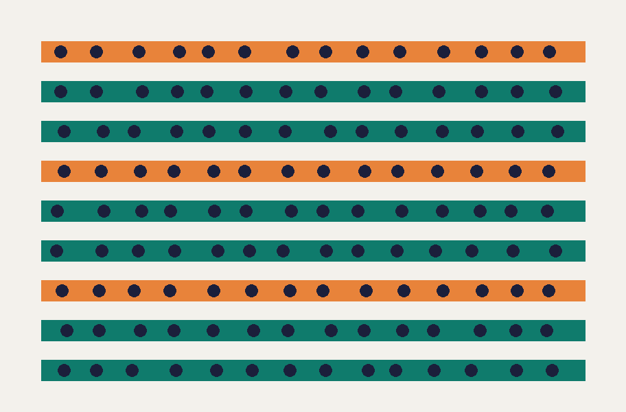

<!-- slide: title -->
# Field trial review, Q3

Orchard robotics team · October 2026

---

<!-- slide: bullets -->
# What we set out to learn

- Can one picker robot work a full row unattended?
- How often does a person need to step in?
  - per row, and per hour of picking
- What breaks first in wet weather?

> [!note]
> Keep this short; the answers come on the next slides.

---

<!-- slide: kpi -->
# Unattended rows

## value
86%

## label
of rows finished with no one stepping in

## context
Up from 61% in the spring trial, over 412 rows on three farms.

---

<!-- slide: two-column -->
# Spring and autumn

## left
- Stopped at every ladder
- Lost GPS under netting
- Gripper slipped when wet

## right
- Routes round ladders
- Rows mapped from the drone
- New gripper pads

---

<!-- slide: image -->
# The row map

Each row is mapped from the drone before the robot enters it, so netting no longer matters.

---

<!-- slide: table -->
# Stops per hour, by cause

| Cause | Spring | Autumn |
|---|---|---|
| Ladder in the row | 3.1 | 0.4 |
| GPS lost | 2.2 | 0.1 |
| Gripper slip | 1.4 | 0.6 |
| Battery swap | 0.5 | 0.5 |

---

<!-- slide: quote -->
It finished the row while we had lunch. That's the first time it's felt like help rather than a demo.

## who
Grower, Hollins Farm

---

<!-- slide: section -->
# Next season

## number
02

---

<!-- slide: bullets -->
# Asks

- Two more farms for the winter trial
- A second gripper design to compare
- Battery swaps without stopping the row

> [!note]
> Close on the asks; leave the risks for questions.
