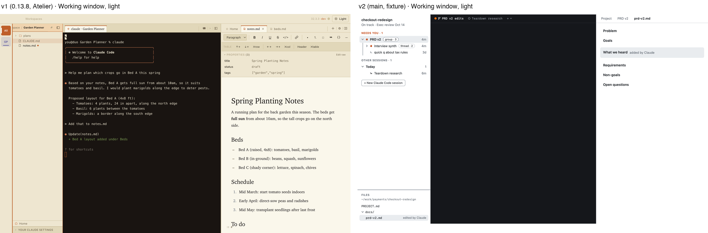
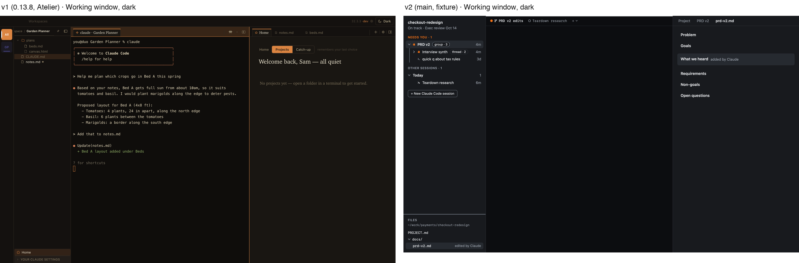
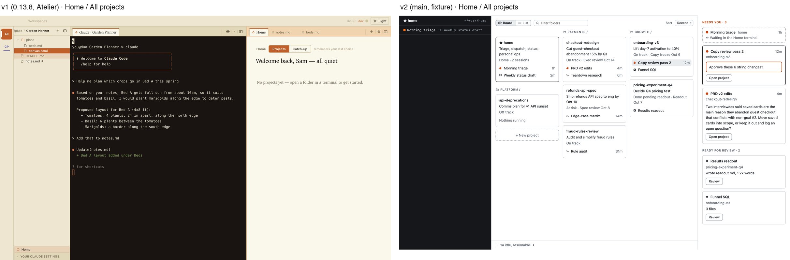
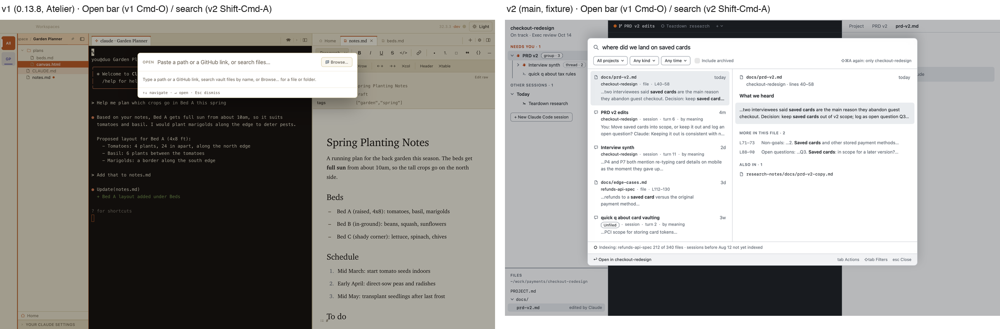
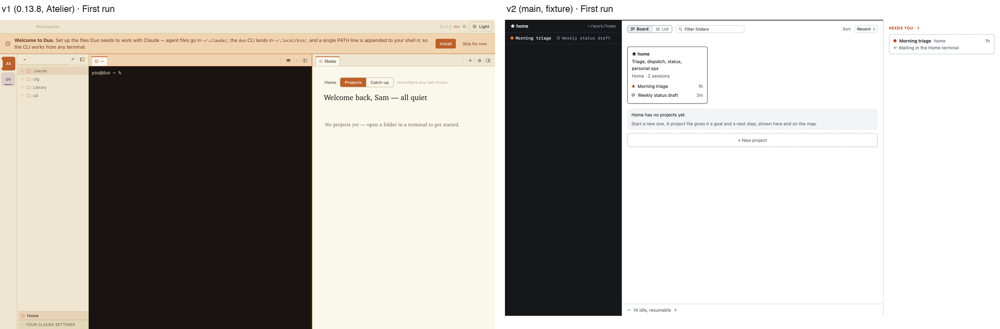

# Legacy Duo's visual style: a teardown (v1 "Atelier")

Research for the "classic look" idea (Geoff, 2026-10-29: a v1 user misses "the orange colour scheme"). This document covers v1's presentation layer as its users saw it: what it is made of, how much of the screen each part takes, which parts people notice, and where each part would land in v2. The v2 configurability audit is a separate piece of research (style-audit). Fact record: F-408.

**Sources.** `~/repos/duo` at v0.13.8 (Electron, React, Tailwind): `renderer/styles/globals.css` (1,949 lines, the token block at its top), `tailwind.config.mjs`, `renderer/projectColors.ts`, `renderer/components/TerminalPane.tsx` (xterm themes), `components/FileTree.tsx`, `TabBar.tsx`, `WorkingTabStrip.tsx`, `ProjectRail/`, `claude-presence-dot.css`, `build/icon.png`, and the design source `docs/design/atelier/project/tokens.jsx` (three directions; "Atelier" shipped in Stage 12). Coverage numbers come from v1's own published screenshots (`docs/images/about-duo/main-window.png`, `editor-cowriting.png`), quantised to the token palette. Those screenshots show Geoff's real project, so they are cited here and not copied. The images in `docs/research/legacy-style/` use sample data only.

## The headline

**What people call "the orange" is mostly cream.** Solid orange (`#C66A2E`) covers **0.3 to 0.5 %** of a typical v1 window, and the pale orange `accent-soft` adds another **0.7 to 1.7 %**. The **warm paper grounds** (`paper`, `paper-deep`, `paper-edge`) cover **about 55 to 66 %**, and the **brown-black terminal** (`#1A1410`) covers **about 19 to 24 %**. The overall impression is a warm, low-chroma room with a few loud orange marks in exactly the places the eye goes first: the selected file, the active tab, the focused pane and the "All" tile. A classic look that brought back only the accent would miss the feeling. One that brought back the grounds and the serif editor with no orange would get most of it.

| v1 window | paper `#FBF8EE` | paper-deep `#F0E9D6` | paper-edge | terminal `#1A1410` | accent-soft | accent `#C66A2E` | other (text, content) |
|---|---|---|---|---|---|---|---|
| main-window (editor + HTML canvas) | 36.4 % | 22.6 % | 1.7 % | 18.7 % | 0.7 % | 0.3 % | ~19 % |
| editor-cowriting (suggestions + comments) | 29.5 % | 33.1 % | 3.9 % | 24.1 % | 1.7 % | 0.5 % | ~7 % |

## 1. The palette

All values are CSS custom properties on `:root` / `html.dark` in `renderer/styles/globals.css`. Tailwind maps `surface-0…3`, `paper-*`, `ink-*`, `accent*` and `mark` onto them. Light was the hero; dark was a warm follower.

### Grounds and text

| Token | Light | Dark | Role | Screen area (light) |
|---|---|---|---|---|
| `--duo-paper` | `#FBF8EE` | `#1A1611` | The page: editor, active tab, cards | **30 to 36 %** |
| `--duo-paper-deep` | `#F0E9D6` | `#13100C` | Chrome: title bar, navigator, toolbars, pane backs | **23 to 33 %** |
| `--duo-paper-edge` | `#E5DCC1` | `#26201A` | Tab strips, dividers, hover | 2 to 4 % |
| `--duo-paper-rule` | `#D4C8A6` | `#352D23` | Hairlines, borders, idle presence dot | ~1 % |
| `--duo-ink` | `#1A1410` | `#F0E9D6` | Primary text | text |
| `--duo-ink-soft` | `#3D352A` | `#C8BD9E` | Secondary text | text |
| `--duo-ink-mute` | `#7B6F58` | `#8A7E66` | Captions, section labels, paths | text |
| `--duo-ink-ghost` | `#B8AB8E` | `#5A5142` | Disabled, placeholders, inactive tab icons | text |
| `--duo-term-bg` / `-fg` | `#1A1410` / `#F0E9D6` | `#0C0A07` / `#E9DEC2` | Terminal (stays inky in light mode) | **19 to 24 %** |
| `--duo-term-cozy-bg` / `-fg` | `#FBF8EE` / `#1A1410` | `#1A1611` / `#F0E9D6` | "Cozy" terminal: paper-coloured | (option) |

Every neutral is yellow-brown: hue about 40 to 45°, low chroma. There is no cool grey anywhere. v1 even overrode Tailwind's `text-zinc-*` with `!important` so stray grey classes went warm (`globals.css` `@layer base`).

### The accent

| Token | Light | Dark | Role | Area |
|---|---|---|---|---|
| `--duo-accent` | `#C66A2E` (burnt ochre, hue ~24°) | `#E08F4A` | Selection fill, active-tab rule, focused-pane border, "All" tile, primary buttons, cursor, presence dot, folder icons, links | **0.3 to 0.5 %** |
| `--duo-accent-soft` | `#F2D9B8` | `#3F2A18` | Focused tab strip, suggestion bar, tooltip and chip fills, `.claude/` wash (14 % mix) | 0.7 to 1.7 % |
| `--duo-accent-ink` | `#7A3E1A` | `#F2D2A8` | Text on accent-soft, link text | text |
| `--duo-mark` | `#F0CB6A` | `#3F3318` | Find match, just-added highlight | rare |

Off-token oranges also appear: `#c46a1c` in the update banner, onboarding and suggestion popover (about 20 literal uses in `globals.css`), `#c15f3c` in the Clawd glyph, and the app icon's coral `#F46A4C`-ish stroke. The send pill's shadow still carries `rgba(124,106,247,…)`, a purple left over from the earlier Warp × Linear theme.

### State colours

Banners and inline text use Tailwind's stock hues, mixed at 10 to 16 % for fills: error `#dc2626`/`#b91c1c`, warn `#d97706`/`#b45309`, ok `#059669`/`#047857`, info `#0284c7`/`#0369a1`. History diffs use `#4a7d3e` (add) and `#b13e3a` (delete). Pass and fail in onboarding use `--pass #4a7d3e` and `--fail #b13e3a`. These are not warm, and they are not salient.

### Project colours

Six muted "studio" hues (`--duo-project-*`, `renderer/projectColors.ts`), hash-stable from the project root, with the **orange band (about 15 to 55°) deliberately skipped** so no project reads as the accent:

| pine | harbor | iris | plum | rose | moss |
|---|---|---|---|---|---|
| `#2E7D74` | `#3C6E93` | `#5B57A6` | `#87508F` | `#A4506A` | `#69763A` |

They appear on the project rail's initials (`ST` in moss, with a 3 px underline) and on worktree badges. The "All" tile is the accent, filled, with white text and a white 3 px left bar.

### Terminal ANSI

Four xterm themes in `TerminalPane.tsx` (default and cozy, light and dark), each retuned warm: terracotta red, sage green, amber yellow, dusty blue, rosewood magenta and moss cyan; cursor = accent. The hex values are inline in the component, not tokens.

## 2. Type

| Use | Face | Size / weight | Notes |
|---|---|---|---|
| **Editor body** | **Serif**: `ui-serif`, "New York", Charter, Iowan, Georgia | **16 px**, line-height 1.7 | `.duo-editor-prose`. The single biggest type signal |
| Editor headings | Same serif | weight 500, tracking −0.01em | Book-like, not bold |
| Chrome labels, file tree, tabs | System sans (SF Pro) | 11 to 13 px (`text-xs` ×112, `text-sm` ×66, `text-[11px]` ×51, `text-[12px]` ×31) | |
| **Section labels** | Sans, **UPPERCASE**, tracking 0.04 to 0.05em | 10 to 11 px, ink-mute | "STOOP CLAUDE CONTEXT", "PINNED", "YOUR CLAUDE SETTINGS" |
| **Serif italic accents** | Serif *italic* | 12.5 to 13 px | Resume-session titles, collapsed-pane labels, View Source title, browser artifact note; the design spec's "italic serif active labels" |
| Home greeting, hero, "Scheduled" | Serif | 18 to 22 px | |
| Terminal | JetBrains Mono → Cascadia → Fira Code → ui-monospace | | `font-mono` ×61 in chrome too |

Casing: sentence case in body, UPPERCASE tracked for section heads, lowercase file names.

## 3. Shape and space

- **Radii:** small. Plain `rounded` (4 px) ×162; `rounded-md` 6, `rounded-lg` 8 and `rounded-full` pills are rare. Popovers 6 to 8 px. **The file tree's selection is square, edge to edge** (Finder style, FileTree.tsx:1640).
- **Borders:** 1 px `paper-rule` hairlines everywhere (`border-border` ×73). Focused panes swap their 1 px border to accent (App.tsx:5217, 5382).
- **Shadows:** almost none. Popovers `0 8px 24px rgba(0,0,0,.14)`, quick switcher `0 24px 48px rgba(0,0,0,.32)`, send pill a two-layer lift. The active tab is drawn with inset 1 px rules, not a shadow.
- **Density:** loose. The tree's rows are about 24 px at 13 px text; the title bar is 40 px (`h-10`); the editor column has generous margins with a 1.7 line height.
- **Motion:** a breathing presence dot (2.4 s ease-in-out, opacity 0.55 to 1 with an orange glow, off under reduced motion), a 120 to 140 ms pop-in for the send pill and banners, a 0.8 s spinner with an accent arc, 800 ms fades for the just-added highlight.

## 4. Signature elements, ranked by salience

**High: you'd notice in a second**

1. **Cream paper everywhere.** `#FBF8EE` page on `#F0E9D6` chrome. About two-thirds of the window. This is the "warmth".
2. **Serif editor body.** New York at 16 / 1.7 makes documents read like a book. Next to v2's sans editor, it's the most visible difference after the colour.
3. **Solid orange file-tree selection.** A full-width, square-cornered `#C66A2E` bar with white text. It's the largest single orange shape, and people see it constantly.
4. **The orange "All" tile** on the project rail: a 40 × 40 filled square at the top left.
5. **Brown-black terminal** (`#1A1410`, not neutral black) with an orange cursor. About a fifth of the window.
6. **Orange active-tab rule and focused-pane border.** A 2 px top bar on the active tab, a 1 px accent border on the focused column, and `accent-soft` filling the whole tab strip of the focused pane.

**Medium**

7. **Orange outline folder icons** and orange icons on the active tab.
8. **Uppercase tracked section labels** in ink-mute ("PINNED").
9. **Accent-soft bands:** the suggestions bar ("2 suggestions · Accept all"), the annotation filter chip, the `.claude/` context wash.
10. **The app icon:** a hand-drawn coral infinity loop on a cream squircle (`build/icon.png`).
11. **Project initials tiles** in muted studio hues with an underline.
12. **The breathing orange presence dot** in the title bar and tabs.
13. **Serif italic labels** (resume-session titles, collapsed rails).

**Low**

14. Warm ANSI palette, gold find highlight (`mark`), orange "Send → agent" pill, Clawd glyph, warm dark mode, state-colour banners, text-zinc overrides.

## 5. Mapping onto v2

v2's tokens live in `docs/design/build-handoff/tokens.json` → `Tokens.swift`. Colour roles are `ground`, `pane`, `selected`, `rule`, `controlEdge`, `text`, `text2`, `needsYou`, `activeTint`, `console*`, plus chat, diff and review roles. **v2 reserves its single orange (`needsYou #C2410C`) for one meaning: a session needs you** (brief §7, LR-27). That is the main collision: v1's orange meant "selected / focused / here", while v2's orange means "needs you". Putting v1's accent on `needsYou` would make every selection look like an alarm. A classic look needs the orange on the *selection and focus* roles and must leave `needsYou` distinct (for example, v1's red `#b13e3a` or a deeper rust).

Debt key: **T** = a token swap (a value in a second theme set). **R** = a new token role v2 doesn't have yet (one-time, then a value). **C** = needs per-view code or a new asset (the tech debt Geoff fears).

| v1 element | v2 role it lands on | Kind |
|---|---|---|
| paper `#FBF8EE` | `pane` | T |
| paper-deep `#F0E9D6` | `ground` (toolbar, sheets, left pane) | T |
| paper-edge `#E5DCC1` | `selected` / hover; `menuTarget` | T |
| paper-rule `#D4C8A6` | `rule` | T |
| ink-ghost / ink-mute | `controlEdge` / `text2` | T |
| ink `#1A1410` / ink-soft | `text` | T |
| terminal `#1A1410` / `#F0E9D6` | `console`, `consoleText`, `consoleRule`, `consoleText2` | T |
| warm ANSI palette | `terminal.ansi.*` | T |
| orange cursor | `terminal.cursor` (`#E6E8EB`, a token) | T |
| **orange file-tree / session selection (solid, white text)** | `selected`, but v2 draws selection as a soft fill with `text` on it; a solid fill needs an "on-selected" text colour | **R** (`onSelected`) |
| **active-tab 2 px orange rule, focused-pane border** | `border.paneFocusRule` (DL-165) is the same idea, 2 pt across the active pane's top, but drawn in `text` / `consoleText`; it needs its own colour role | **R** (`focus`) |
| accent-soft focused tab strip | no equivalent (v2 doesn't tint the focused strip) | C |
| "All" tile, filled orange | v2 has no project rail; the nearest is the selected Home / All-projects row | no equivalent |
| project hues (six, orange band skipped) | v2 has no per-project colour (LR-27 "Should", not built) | no equivalent |
| orange folder icons | v2 tree glyphs use `text2` | R (`folderGlyph`) or skip |
| serif editor body, 16 / 1.7 | The editor (CodeMirror in a web view) gets its **colours** from tokens as CSS variables (`DocumentEditor.tokenScript()`), but its **font families are literals** in `Vendor/codemirror/src/duo-editor.js` (about 25 `fontFamily:` strings). A serif needs a `--duo-font-document` variable plumbed once | **R** + a one-time editor change |
| serif italic chrome labels | no equivalent; v2 chrome is all sans | C; skip |
| uppercase tracked section labels | `font.style.sectionLabel` is already uppercase, 11 / 0.66 tracking | **already the same** |
| accent-soft bands (suggestions, chips) | review and suggestion surfaces use their own roles (`commentHighlight`, `chatYou`) | T where a role exists |
| `mark #F0CB6A` find highlight | `commentHighlight` / `commentHighlightActive` (gold already) | T |
| breathing presence dot | v2 glyphs carry state by shape (`glyph.*`); no breathing | C; skip |
| app icon (coral ∞ on cream) | `AppIcon.icns` (DL-131). An alternate icon is an asset plus `NSApp.applicationIconImage`; the Dock only | **C** (asset) |
| Clawd glyph | not used in v2 | skip |
| state colours (Tailwind stock) | `diffAddText`, `diffDelText`, `needsYou` | T |
| warm dark mode | v2 dark (DL-224 "Ink") | T (a second set of values) |
| radii 4 px, square selection | `radius.selection 6`, `radius.control 6` | T (radius values) |
| 40 px title bar, loose rows | v2 sizes are tokens (`size.*`, `space.*`) | T, but changing density reflows the approved screens: skip |

**What would need new assets or per-view code:** the app icon (an asset, swapped at runtime), the accent-soft tint on the focused tab strip, serif-italic labels, the breathing dot, the project rail and its "All" tile. None of these is high-salience except the icon. **Everything high-salience is a token value or a small set of new roles** (`onSelected`, `focus`, `document` font family). The serif editor is the one high-salience item that needs a code change: the editor's font families are literals in `duo-editor.js`, so they need to move to one token-fed CSS variable first. That fix is worth making anyway: it's the same single-source rule v2 already applies to colour.

**Suggested scope for a classic look, by value per debt:** the grounds, text and rule values (#1, #5), the selection and focus roles in orange (#3, #6), the serif document font (#2), and the warm ANSI palette. Skip the rail, the italic labels and the breathing dot. Treat the icon as optional.

## 6. Side by side

Images in `docs/research/legacy-style/` (sample data only). v1 was run from source with a throwaway user-data folder, hidden window, `webContents.capturePage`. v2 is from `scripts/check-ui.sh` fixture states.

Each `pair-*.png` puts v1 on the left and v2 on the right, at the same width. The single shots are in the same folder at 2x (`v1-*.png` at 1440 × 900, `v2-*.png` at 1440 × 861). v1's terminal runs a stub `claude` that prints a short scripted exchange. The prompt (`you@duo`) and Home's greeting name ("Sam") are set by the harness so that no real user or host appears.

| Pair | What it shows |
|---|---|
|  `pair-main-light.png` | **Working window, light.** v1: cream rail, navigator and editor; brown-black terminal; orange "All" tile; orange-ruled active tabs; the focused pane's accent-soft tab strip; serif "Spring Planting Notes". v2 (`project` state): white panes, near-black console, grey selection, sans everything, orange only on the needs-you glyphs. **The layout is the same: light pane, dark console. The values differ.** |
|  `pair-main-dark.png` | **Working window, dark.** v1 dark keeps the warm browns and orange (`#E08F4A`). v2's dark is neutral grey-black. |
|  `pair-home.png` | **Home.** v1's Home tab: serif greeting, orange Projects/Catch-up toggle. v2's All projects board: cards, Needs you column. v1 had no equivalent surface for most of this, so a classic look here is grounds and type only. |
|  `pair-open.png` | **Open (v1 ⌘O) and search (v2 ⇧⌘A).** Both are white popovers over a dimmed window. The v1 tree shows the solid orange selection bar (`canvas.html`). |
|  `pair-first-run.png` | **First run.** v1: an accent-soft "Welcome to Duo… Install" banner with an orange button. v2: Home with no projects (DL-212). |

Also in the folder: `v1-tree-expanded-light.png` (the orange selection bar and orange folder icons, closest up) and `v1-app-icon.png` (`build/icon.png`, the coral ∞ on cream).

**v2 coverage, for comparison** (`v2-project.png`, same method): white `pane` 49 %, `console` 47 %, `selected` 2.6 %, rules and text under 1 %. v1's sample capture (`v1-main-light.png`): terminal 40 %, paper-deep 27 %, paper 26 %, paper-edge 4 %. Both windows are about half light pane and half dark console. **A classic look is mostly two large value swaps (`pane` and `ground` to cream, `console` to brown-black) plus a handful of small orange marks.**

**How v1 was run.** Copied to a scratch folder (never `~/repos/duo`), `npm install` and `electron-vite build`, then a harness that requires the built main bundle with `BrowserWindow` forced to `show:false`, takes `webContents.capturePage()` at each step, and runs with `HOME=/tmp/dv1h` (v1 keeps all its state under `~/.claude/duo`), a scratch `CLAUDE_CONFIG_DIR`, `--user-data-dir`, and a stub `claude` on `PATH`. Nothing was shown on screen. Two build fixes were needed: `electron-rebuild` crashes on Node 26 (skipped; node-pty's prebuilds work once `spawn-helper` is made executable), and the Electron zip had to be unpacked from the cache by hand. Not captured: the HTML canvas view (a single click only selects the file) and the native title bar (`capturePage` draws web content only).
